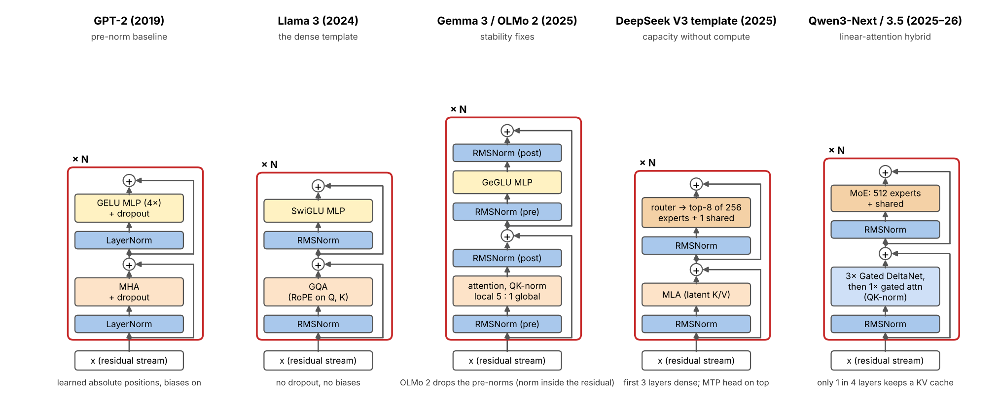
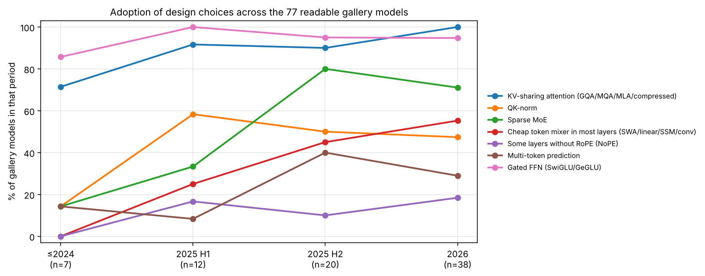
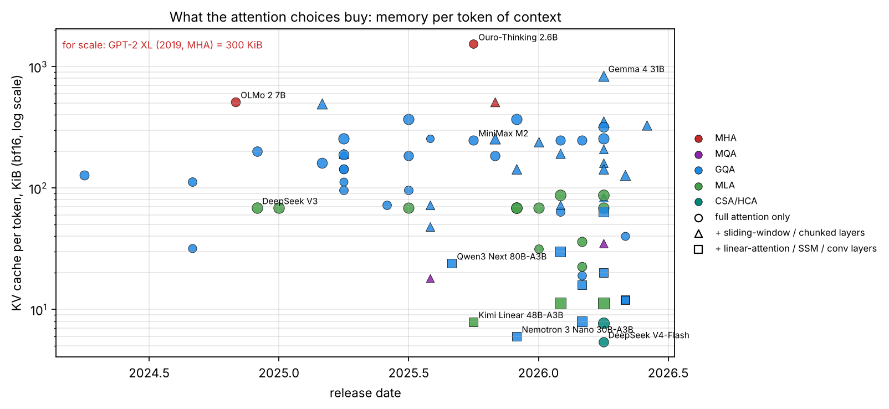

# LLM architecture design: what the gallery shows, and the reasons behind each layer

[back to the folder](README.md) · data and figures: [`llm_architectures.py`](llm_architectures.py) ·
table as CSV: [`llm_architectures.csv`](llm_architectures.csv) · the blocks themselves:
[building blocks](../15-neural-networks/building-blocks.md) · one level down, mechanism by mechanism:
[inside a modern LLM block](llm-block-mechanisms.md)

**Source.** Sebastian Raschka's [LLM Architecture Gallery](https://sebastianraschka.com/llm-architecture-gallery/),
read on 2026-11-19. The gallery lists 126 open-weight LLMs. The cards of **77** of them could be read, and those 77
are coded field by field in `llm_architectures.py`. They run from GPT-2 (2019) to models released in mid-2026. The
other 49 are named in the gallery's menus, but their cards were not in the page text that could be fetched. They are
listed at the end of this page, and the counts here leave them out.

**The question.** Neural-network design is mostly trial and error. Hamed's question was whether the gallery shows
rules: which layer comes after which, where normalization goes, when to use dropout. The short answer:

- **About half the decisions are close to settled.** Every model since 2024 makes them the same way, and there is a
  mechanism behind each one that you can state and test. Examples: residual stream, pre-normalization, RMSNorm,
  gated MLP, RoPE, no dropout and no biases in pretraining, shared K/V heads.
- **The other half are forced by cost, not quality.** The KV cache, active parameters and long context drive them:
  sliding windows, linear-attention hybrids, MLA, mixture of experts. The *direction* follows from arithmetic you can
  do in advance. The *numbers* (3:1 or 5:1, 128 or 512 experts, window 128 or 4096) are tuned, and the labs disagree.
- **A small set of fixes target training instabilities** that appear only at scale: QK-norm, extra norms, gated
  attention, dense first layers. Each is backed by the lab's own ablations, but there is no shared theory yet, and
  the models disagree with each other.

The rest of the page has the evidence: a classification, the comparison table, the trends, and then the engineering
process step by step, with an evidence level on every step. For the settled mechanisms, [inside a modern LLM block](llm-block-mechanisms.md)
goes deeper: what each one computes, exactly where it sits in the block, the role it plays, and what breaks without
it, with a small experiment for each.

**Evidence levels used below**

| Mark | Meaning |
| --- | --- |
| ●●● **established** | a known mechanism, controlled ablations from several groups, and near-universal adoption in the gallery |
| ●●○ **supported** | ablations at scale, mostly from the lab that introduced it; a plausible mechanism; wide but not universal adoption |
| ●○○ **convention / tuned** | it works, but the specific choice is tuned per lab, the models disagree, or adoption follows a template more than evidence |

## How the block changed, 2019 → 2026



From left to right, each block adds one idea to the previous one.

1. **GPT-2** already had the modern skeleton: pre-norm residual blocks with attention then MLP.
2. **Llama 3** swaps the parts for cheaper or better ones: RMSNorm, RoPE, GQA, SwiGLU. It also deletes dropout and
   biases.
3. **Gemma 3 and OLMo 2** add normalization for stability at scale: QK-norm, and norms after the sub-layers. Gemma 3
   also makes most layers local.
4. **DeepSeek V3** replaces the MLP with a mixture of experts and compresses K/V into a latent vector (MLA).
5. **Qwen3-Next / 3.5** replaces three of every four attention layers with linear attention (Gated DeltaNet).

## Classification

`family()` in the code sorts every model into one of eight families using two questions. First, is the channel
mixer dense or a mixture of experts? Second, what does the token mixer do in most layers: full attention, local
attention, linear attention, or a state-space/convolution layer?

| Family | What defines it | Models | Examples |
| --- | --- | --- | --- |
| A | dense; full attention in every layer (the Llama template) | 13 | Llama 3, Qwen3 dense, Phi-4, OLMo 2, SmolLM3, Granite 4.1 |
| B | dense; most layers use sliding-window (local) attention | 9 | Gemma 3, Gemma 4, OLMo 3, Tiny Aya |
| C | MoE; full GQA attention | 14 | Qwen3 MoE, GLM-4.5/4.7, MiniMax M2/M2.5/M2.7, Grok 2.5, Tencent Hy3 |
| D | MoE + MLA or compressed attention (the DeepSeek V3 template) | 14 | DeepSeek V3/R1/V3.2/V4, Kimi K2/K2.5/K2.6, Mistral Large 3, GLM-5 |
| E | MoE; local:global attention | 11 | GPT-OSS, Llama 4 Maverick, MiMo-V2, Step 3.5, Arcee Trinity, Gemma 4 26B-A4B |
| F | linear-attention hybrid (Gated DeltaNet, Kimi Delta Attention, Lightning) | 7 | Qwen3-Next, Qwen3.5, Qwen3.6, Kimi Linear, Ling 2.5/2.6 |
| G | state-space or convolution hybrid (Mamba-2, LIV conv) | 6 | Nemotron 3 Nano/Super, LFM2.5 |
| H | outliers: learned positions, no attention, or looped | 3 | GPT-2 XL, xLSTM 7B, Ouro 2.6B |

Two observations about the families:

- **Templates spread more than ideas do.** Family D is mostly copies of DeepSeek V3 with different expert counts.
  The cards for Kimi K2, Mistral Large 3, GLM-5 and DeepSeek V3.2 say so. Family C is mostly Qwen3-MoE-like.
  Adoption shows that a recipe was trusted, not that it is optimal.
- **Families B–G differ in one place only: what most layers use instead of full attention.** Below the token mixer,
  every model in the gallery is the same block.

## Comparison table

Grouped by family, oldest first inside each family. **n/s** = not stated on the card. **†** = the gallery card does
not state the norm placement, and it was filled in from the model's published config. **Cheap mixer : global** is
the number of layers that use the cheap token mixer next to the number with full attention. **MoE k/E** = routed
experts active per token out of the total. KV/token is the card's KV-cache memory per token of context at bf16.

| Model | Date | Params (active) | Layers | Global attn | Cheap mixer : global | QK-norm | Norm | Positions | Channel mixer | MTP | KV/token |
| --- | --- | --- | --- | --- | --- | --- | --- | --- | --- | --- | --- |
| **A. Dense, full attention (Llama template)** | | | | | | | | | | | |
| Llama 3 8B | 2024-04 | 8B | 32 | GQA | – | – | pre† | RoPE | SwiGLU | – | 128 KiB |
| Llama 3.2 1B | 2024-09 | 1B | 16 | GQA | – | – | pre† | RoPE | SwiGLU | – | 32 KiB |
| Llama 3.2 3B | 2024-09 | 3B | 28 | GQA | – | – | pre† | RoPE | SwiGLU | – | 112 KiB |
| OLMo 2 7B | 2024-11 | 7B | 32 | MHA | – | yes | post-inside | RoPE | SwiGLU | – | 512 KiB |
| Phi-4 14B | 2024-12 | 14B | 40 | GQA | – | – | pre | RoPE | SwiGLU | – | 200 KiB |
| Mistral Small 3.1 24B | 2025-03 | 24B | 40 | GQA | – | – | pre† | RoPE | SwiGLU | – | 160 KiB |
| Qwen3 0.6B | 2025-04 | 0.6B | 28 | GQA | – | yes | pre† | RoPE | SwiGLU | – | 112 KiB |
| Qwen3 32B | 2025-04 | 32B | 64 | GQA | – | yes | pre† | RoPE | SwiGLU | – | 256 KiB |
| Qwen3 4B | 2025-04 | 4B | 36 | GQA | – | yes | pre† | RoPE | SwiGLU | – | 144 KiB |
| Qwen3 8B | 2025-04 | 8B | 36 | GQA | – | yes | pre† | RoPE | SwiGLU | – | 144 KiB |
| SmolLM3 3B | 2025-06 | 3B | 36 | GQA | – | – | pre† | RoPE+NoPE | SwiGLU | – | 72 KiB |
| Nanbeige 4.1 3B | 2026-02 | 3B | 32 | GQA | – | – | pre† | RoPE | SwiGLU | – | 64 KiB |
| Granite 4.1 30B | 2026-04 | 30B | 64 | GQA | – | – | pre† | RoPE | SwiGLU | – | 256 KiB |
| **B. Dense, local:global attention** | | | | | | | | | | | |
| Gemma 3 27B | 2025-03 | 27B | 62 | GQA | SWA 52:10 | yes | sandwich | RoPE | GeGLU | – | 496 KiB |
| Gemma 3 270M | 2025-08 | 0.27B | 18 | MQA | SWA 15:3 | yes | sandwich | RoPE | GeGLU | – | 18 KiB |
| OLMo 3 32B | 2025-11 | 32B | 64 | GQA | SWA 48:16 | yes | post-inside | RoPE | SwiGLU | – | 256 KiB |
| OLMo 3 7B | 2025-11 | 7B | 32 | MHA | SWA 24:8 | yes | post-inside | RoPE | SwiGLU | – | 512 KiB |
| Tiny Aya 3.35B | 2026-02 | 3.35B | 36 | GQA | SWA 27:9 | – | parallel | RoPE+NoPE | SwiGLU | – | 72 KiB |
| Gemma 4 31B | 2026-04 | 30.7B | 60 | GQA | SWA 50:10 | yes | sandwich | partial RoPE | GeGLU | – | 840 KiB |
| Gemma 4 E2B | 2026-04 | 5.1B | 35 | MQA | SWA 28:7 | yes | sandwich | partial RoPE | GeGLU | – | 35 KiB |
| Gemma 4 E4B | 2026-04 | 8B | 42 | GQA | SWA 35:7 | yes | sandwich | partial RoPE | GeGLU | – | 84 KiB |
| Gemma 4 12B | 2026-06 | 12B | 48 | GQA | SWA 40:8 | yes | sandwich | partial RoPE | GeGLU | – | 328 KiB |
| **C. MoE, full GQA attention** | | | | | | | | | | | |
| Qwen3 235B-A22B | 2025-04 | 235B (22B) | 94 | GQA | – | yes | pre† | RoPE | MoE 8/128 no shared (SwiGLU) | – | 188 KiB |
| Qwen3 30B-A3B | 2025-04 | 30B (3B) | 48 | GQA | – | yes | pre† | RoPE | MoE 8/128 no shared (SwiGLU) | – | 96 KiB |
| GLM-4.5 | 2025-07 | 355B (32B) | 92 | GQA | – | yes | pre† | RoPE | MoE 8/160 +shared (SwiGLU) | yes | 368 KiB |
| Qwen3 Coder Flash 30B-A3B | 2025-07 | 30B (3.3B) | 48 | GQA | – | yes | pre† | RoPE | MoE 8/128 no shared (SwiGLU) | – | 96 KiB |
| GLM-4.5-Air | 2025-07 | 106B (12B) | 46 | GQA | – | yes | pre† | RoPE | MoE +shared (SwiGLU) | yes | 184 KiB |
| Grok 2.5 | 2025-08 | 270B (n/s) | 64 | GQA | – | – | n/s | RoPE | MoE 2/8 +shared (SwiGLU) | – | 256 KiB |
| MiniMax M2 | 2025-10 | 230B (10B) | 62 | GQA | – | yes | pre† | partial RoPE | MoE 8/256 (SwiGLU) | yes | 248 KiB |
| INTELLECT-3 | 2025-11 | 106B (12B) | 46 | GQA | – | yes | pre† | RoPE | MoE +shared (SwiGLU) | yes | 184 KiB |
| GLM-4.7 | 2025-12 | 355B (32B) | 92 | GQA | – | yes | pre† | RoPE | MoE 8/160 +shared (SwiGLU) | yes | 368 KiB |
| MiniMax M2.5 | 2026-02 | 230B (10B) | 62 | GQA | – | yes | pre† | partial RoPE | MoE (SwiGLU) | yes | 248 KiB |
| Sarvam 30B | 2026-03 | 30B (2.4B) | 19 | GQA | – | yes | n/s | RoPE | MoE (SwiGLU) | – | 19 KiB |
| MiniMax M2.7 | 2026-03 | 230B (10B) | 62 | GQA | – | yes | pre† | partial RoPE | MoE (SwiGLU) | yes | 248 KiB |
| Tencent Hy3-preview | 2026-04 | 295B (21B) | 80 | GQA | – | yes | n/s | RoPE | MoE 8/192 +shared (SwiGLU) | yes | 320 KiB |
| ZAYA1-8B | 2026-05 | 8.4B (0.76B) | 40 | GQA | – | yes | n/s | RoPE | MoE top-1 (SiLU) | – | 40 KiB |
| **D. MoE + MLA (DeepSeek template)** | | | | | | | | | | | |
| DeepSeek V3 | 2024-12 | 671B (37B) | 61 | MLA | – | – | n/s | RoPE | MoE 8/256 +shared (SwiGLU) | yes | 68.6 KiB |
| DeepSeek R1 | 2025-01 | 671B (37B) | 61 | MLA | – | – | n/s | RoPE | MoE 8/256 +shared (SwiGLU) | yes | 68.6 KiB |
| Kimi K2 | 2025-07 | 1000B (32B) | 61 | MLA | – | – | pre† | RoPE | MoE 8/384 +shared (SwiGLU) | – | 68.6 KiB |
| DeepSeek V3.2 | 2025-12 | 671B (37B) | 61 | MLA | DSA | – | pre† | RoPE | MoE 8/256 +shared (SwiGLU) | yes | 68.6 KiB |
| Mistral Large 3 | 2025-12 | 673B (41B) | 61 | MLA | – | – | pre† | RoPE | MoE +shared (SwiGLU) | – | 68.6 KiB |
| Kimi K2.5 | 2026-01 | 1000B (32B) | 61 | MLA | – | – | pre† | RoPE | MoE 8/384 +shared (SwiGLU) | – | 68.6 KiB |
| LongCat-Flash-Lite | 2026-01 | 68.5B (3B) | 28 | MLA | – | – | n/s | RoPE+NoPE | MoE 12/256 (SiLU) | – | 31.5 KiB |
| GLM-5 | 2026-02 | 744B (40B) | 78 | MLA | DSA | – | n/s | RoPE | MoE (SwiGLU) | yes | 87.8 KiB |
| Sarvam 105B | 2026-03 | 105B (10.3B) | 32 | MLA | – | – | n/s | RoPE+NoPE | MoE (SwiGLU) | – | 36 KiB |
| Mistral Small 4 | 2026-03 | 119B (6.63B) | 36 | MLA | – | – | n/s | RoPE | MoE 4/128 +shared (SwiGLU) | – | 22.5 KiB |
| DeepSeek V4-Flash | 2026-04 | 284B (13B) | 43 | CSA/HCA | – | – | n/s | RoPE | MoE 6/256 +shared (SwiGLU) | yes | 5.4 KiB |
| DeepSeek V4-Pro | 2026-04 | 1600B (49B) | 61 | CSA/HCA | – | – | n/s | RoPE | MoE 6/384 +shared (SwiGLU) | yes | 7.7 KiB |
| GLM-5.1 | 2026-04 | 744B (40B) | 78 | MLA | DSA | – | n/s | RoPE | MoE (SwiGLU) | yes | 87.8 KiB |
| Kimi K2.6 | 2026-04 | 1000B (32B) | 61 | MLA | – | – | pre† | RoPE | MoE 8/384 +shared (SwiGLU) | – | 68.6 KiB |
| **E. MoE, local:global attention** | | | | | | | | | | | |
| Llama 4 Maverick | 2025-04 | 400B (17B) | 48 | GQA | chunked 36:12 | – | pre† | RoPE+NoPE | MoE 1/128 +shared (SwiGLU) | – | 192 KiB |
| GPT-OSS 120B | 2025-08 | 117B (5.1B) | 36 | GQA | SWA 18:18 | – | pre† | RoPE | MoE 4/128 no shared (SwiGLU) | – | 72 KiB |
| GPT-OSS 20B | 2025-08 | 21B (3.6B) | 24 | GQA | SWA 12:12 | – | pre† | RoPE | MoE 4/32 no shared (SwiGLU) | – | 48 KiB |
| MiMo-V2-Flash | 2025-12 | 309B (15B) | 48 | GQA | SWA 40:8 | – | n/s | RoPE | MoE (SwiGLU) | yes | 144 KiB |
| Arcee Trinity Large | 2026-01 | 400B (13B) | 60 | GQA | SWA 45:15 | yes | sandwich | RoPE+NoPE | MoE (SwiGLU) | – | 240 KiB |
| Step 3.5 Flash | 2026-02 | 196B (11B) | 48 | GQA | SWA 36:12 | – | n/s | RoPE | MoE (SwiGLU) | yes | 192 KiB |
| Gemma 4 26B-A4B | 2026-04 | 25.2B (3.8B) | 30 | GQA | SWA 25:5 | yes | sandwich | partial RoPE | MoE 8/128 +shared (GeGLU) | – | 210 KiB |
| Laguna XS.2 | 2026-04 | 33B (3B) | 40 | GQA | SWA 30:10 | yes | n/s | RoPE | MoE top-8 +shared (SwiGLU) | – | 160 KiB |
| MiMo-V2.5 | 2026-04 | 310B (15B) | 48 | GQA | SWA 39:9 | – | n/s | RoPE | MoE (SwiGLU) | yes | 144 KiB |
| MiMo-V2.5-Pro | 2026-04 | 1020B (42B) | 70 | GQA | SWA 60:10 | – | n/s | RoPE | MoE 8/384 (SwiGLU) | – | 350 KiB |
| Command A+ | 2026-05 | 218B (25B) | 32 | GQA | SWA 24:8 | – | parallel | RoPE+NoPE | MoE (SwiGLU) | – | 128 KiB |
| **F. Linear-attention hybrid (DeltaNet, KDA, Lightning)** | | | | | | | | | | | |
| Qwen3 Next 80B-A3B | 2025-09 | 80B (3B) | 48 | GQA | DeltaNet 36:12 | yes | pre† | RoPE | MoE 10/512 +shared (SwiGLU) | yes | 24 KiB |
| Kimi Linear 48B-A3B | 2025-10 | 48B (3B) | 27 | MLA | KDA 20:7 | – | pre† | NoPE+recurrent | MoE 8/256 +shared (SwiGLU) | – | 7.9 KiB |
| Ling 2.5 1T | 2026-02 | 1000B (63B) | 80 | MLA | Lightning 70:10 | – | n/s | RoPE | MoE (SwiGLU) | – | 11.2 KiB |
| Qwen3.5 397B | 2026-02 | 397B (17B) | 60 | GQA | DeltaNet 45:15 | yes | pre† | RoPE | MoE None/512 (SwiGLU) | – | 30 KiB |
| Qwen3.6 35B-A3B | 2026-04 | 35B (3B) | 40 | GQA | DeltaNet 30:10 | yes | pre† | RoPE | MoE 8/256 +shared (SwiGLU) | – | 20 KiB |
| Qwen3.6 27B | 2026-04 | 27B | 64 | GQA | DeltaNet 48:16 | yes | pre† | RoPE | SwiGLU | – | 64 KiB |
| Ling 2.6 1T | 2026-04 | 1000B (63B) | 80 | MLA | Lightning 70:10 | – | n/s | RoPE | MoE (SwiGLU) | yes | 11.2 KiB |
| **G. SSM / conv hybrid (Mamba-2, LIV conv)** | | | | | | | | | | | |
| Nemotron 3 Nano 30B-A3B | 2025-12 | 30B (3B) | 52 | GQA | Mamba-2 23:6 | – | pre† | NoPE+recurrent | MoE (ReLU2) | – | 6 KiB |
| Nemotron 3 Super | 2026-03 | 120B (12B) | 88 | GQA | Mamba-2 40:8 | – | pre† | NoPE+recurrent | MoE (ReLU2) | yes | 8 KiB |
| Nemotron 3 Nano 4B | 2026-03 | 4B | 42 | GQA | Mamba-2 21:4 | – | pre† | NoPE+recurrent | ReLU2 | – | 16 KiB |
| LFM2.5 1.2B | 2026-05 | 1.2B | 16 | GQA | conv 10:6 | yes | n/s | RoPE | SiLU | – | 12 KiB |
| LFM2.5 350M | 2026-05 | 0.35B | 16 | GQA | conv 10:6 | yes | n/s | RoPE | SiLU | – | 12 KiB |
| LFM2.5 8B-A1B | 2026-05 | 8.3B (1.5B) | n/s | GQA | conv | yes | n/s | RoPE | MoE 4/32 (SiLU) | – | n/s |
| **H. Outliers: no attention, looped, learned positions** | | | | | | | | | | | |
| GPT-2 XL | 2019-11 | 1.5B | 48 | MHA | – | – | pre† | learned | GELU | – | 300 KiB |
| xLSTM 7B | 2025-03 | 7B | 32 | none | mLSTM 32:0 | – | pre† | none | gated MLP | – | 0 KiB |
| Ouro-Thinking 2.6B | 2025-10 | 2.6B | 48 | MHA | – | – | sandwich | RoPE | SiLU | – | 1536 KiB |

## Trends, with counts

`python llm_architectures.py` prints all of these counts. The periods are release dates: ≤2024 (7 models), 2025 H1
(12), 2025 H2 (20), 2026 (38). Recent models are over-represented, because the gallery adds new releases as they
come out.



| Choice | ≤2024 | 2025 H1 | 2025 H2 | 2026 | Reading |
| --- | --- | --- | --- | --- | --- |
| K/V shared across heads (GQA, MQA, MLA, compressed) | 5/7 | 11/12 | 18/20 | **38/38** | settled; full MHA survives only in OLMo 7B models, Ouro and GPT-2 |
| Gated FFN (SwiGLU, GeGLU) | 6/7 | 12/12 | 19/20 | 36/38 | settled; the exceptions are GPT-2 (GELU) and NVIDIA's ReLU² |
| Sparse MoE | 1/7 | 4/12 | 16/20 | 27/38 | the default above about 30B total parameters |
| Cheap token mixer in most layers | 0/7 | 3/12 | 9/20 | 21/38 | rising; the main open design axis |
| QK-norm (stated on the card) | 1/7 | 7/12 | 10/20 | 18/38 | a lower bound, since many cards omit it |
| Multi-token prediction | 1/7 | 1/12 | 8/20 | 11/38 | spreading with the DeepSeek template |
| Some layers without RoPE (NoPE) | 0/7 | 2/12 | 2/20 | 7/38 | a minority experiment |

**Normalization placement.** Of the 54 models whose placement is known, 40 put the norm in front of each sub-layer
(pre-norm). Nine use a norm both before and after ("sandwich": the Gemma family, Arcee Trinity, Ouro). Three put it
after the sub-layer but inside the residual branch (OLMo 2 and 3). Two run attention and MLP in parallel (Cohere).
**None uses the original Transformer's post-norm, where the norm sits on the residual stream itself.** Every card or
config that names the norm type gives RMSNorm, except GPT-2 (LayerNorm). Cohere's earlier models used LayerNorm.

**Cheap mixer : global ratios** (layers using the cheap mixer for each full-attention layer):

| Cheap mixer | Ratios used |
| --- | --- |
| sliding window | 1 (GPT-OSS) · 3 (OLMo 3, Arcee, Step 3.5, Tiny Aya, Laguna, Command A+) · 4–5 (Gemma 3/4, MiMo-V2) · 6 (MiMo-V2.5-Pro) |
| Gated DeltaNet | exactly 3 in all four Qwen models |
| Kimi Delta Attention | 20:7 ≈ 3 |
| Lightning attention | 7 (Ling 2.5/2.6) |
| Mamba-2 | ≈ 4–5 (Nemotron) |
| short convolution | 10:6 (LFM2.5) |

Only xLSTM drops global attention entirely. Every other model keeps at least one full-attention layer in every eight.

**What these choices buy.** The median KV cache per token is 512 KiB for MHA, 184 KiB for GQA and 69 KiB for MLA. It
is 12 KiB for the linear-attention and SSM hybrids, and about 6.5 KiB for DeepSeek V4's compressed attention: two
orders of magnitude below MHA. The cache at 1M tokens of context is this number times 10⁶. That arithmetic is why
every 1M-context model in the gallery is a hybrid or uses compressed attention.



**Mixture of experts.** 48 of the 77 models are MoE. The median model activates **5.6%** of its parameters per token
(range 3.1%–18%). 22 have an always-on shared expert. Five don't: Qwen3's MoE models and GPT-OSS. Qwen added it back
in Qwen3-Next and 3.6. Several models keep their first one to three layers dense (DeepSeek, Kimi, GLM, Tencent).

## The engineering process, step by step

This is the order in which you would design a decoder LLM today. Each step names the **problem**, the **layer that
solves it and where it goes**, the **evidence**, and **what the gallery shows**. Steps 1–6 give you a dense model
that trains. Steps 7–10 are about cost, and they depend on your budget. Steps 11–13 are about stability and
regularization.

### Step 1: fix the skeleton: a decoder-only stack of residual blocks ●●●

- **Problem.** You need a sequence model that trains in parallel over positions and gets better as you scale it.
- **Layer.** Token embedding → N identical blocks → final norm → linear head over the vocabulary. Each block is a
  *token mixer* (attention) followed by a *channel mixer* (MLP). Each one *adds* its output to a residual stream:
  `x ← x + F(Norm(x))`.
- **Why.** The residual stream gives the gradient an identity path through every block, so depth does not make it
  vanish (He et al. 2016). The [building-blocks notebook](../15-neural-networks/building_blocks.ipynb) shows a
  64-layer network without residuals barely training. Alternating "mix between positions" with "transform each
  position" separates the two jobs.
- **Gallery.** All 77 models. Even xLSTM (a recurrent token mixer) and the Mamba hybrids keep this skeleton. Only
  two variations appear. Cohere runs attention and MLP in parallel off the same norm (a GPT-J/PaLM idea, ~15%
  faster). DeepSeek V4 replaces the plain residual add with manifold-constrained hyper-connections (●○○, new).

### Step 2: put a normalization in front of every sub-layer (pre-norm) ●●●

- **Problem.** In the original post-norm Transformer (`x ← Norm(x + F(x))`), the norm sits on the residual path
  itself. Gradients near the output are large at initialization. Training then needs a careful learning-rate
  warm-up, and it diverges as the model gets deeper.
- **Layer.** `Norm` at the input of attention and of the MLP, *inside* the residual branch, plus one final norm
  before the output head.
- **Why.** With pre-norm, the residual path is a pure sum, so the gradient reaches every layer directly. Xiong et
  al. (2020) show the gradient scale is well behaved at initialization and warm-up becomes much less critical.
- **Gallery.** No model uses original post-norm. Pre-norm is the default (40 of 54 known).
- **Known cost.** With pre-norm, the residual stream's magnitude grows with depth, so later layers contribute
  relatively less. Some activations also grow very large at scale. Step 11 deals with this.

### Step 3: use RMSNorm rather than LayerNorm ●●○

- **Problem.** LayerNorm subtracts the mean, divides by the standard deviation, then adds a learned bias. At LLM
  scale, every norm is memory-bound, so this extra work costs real time.
- **Layer.** RMSNorm: `x / rms(x) · g`. No mean subtraction, no bias.
- **Why.** Zhang & Sennrich (2019) found the re-centering is not what helps. Re-scaling is. RMSNorm matches
  LayerNorm's quality at lower cost. Narang et al. (2021), in a large study of Transformer modifications, found
  RMSNorm among the few that transferred across settings.
- **Gallery.** Every model whose norm type is known uses it, except GPT-2. The evidence for "RMSNorm is *better*" is
  thin. The evidence for "it is *as good and cheaper*" is solid, and that is the reason it won.

### Step 4: give attention position information with RoPE, not with an added embedding ●●●

- **Problem.** Attention is permutation-equivariant: without position information it sees a bag of tokens. GPT-2
  added a learned absolute position vector to the input. That vector cannot represent positions beyond the training
  length, and it is mixed into every feature.
- **Layer.** Rotary embeddings (Su et al. 2021) rotate the **queries and keys** inside each attention layer by an
  angle proportional to position. The `q·k` score then depends only on the *relative* offset. Nothing is added to
  the residual stream.
- **Why.** Relative position is what language needs ("the word two back"). The rotation leaves vector norms intact.
  The context can also be extended later by rescaling the frequencies (YaRN and similar).
- **Gallery.** Every model after GPT-2 uses RoPE or a variant. **Refinements, all ●○○:**
  - *Partial RoPE*: rotate only some of each head's dimensions (MiniMax M2, Gemma 4 global layers).
  - *NoPE layers*: some layers get no position signal at all (SmolLM3 every fourth layer, Llama 4's global layers,
    Arcee, Cohere). Kazemnejad et al. (2023) found causal attention can infer position by itself. The hope is
    better length generalization, but at scale the evidence comes mainly from the adopting labs.
  - In hybrids, the recurrent or convolutional layers already carry order, so Nemotron and Kimi Linear drop RoPE
    from their few attention layers.

### Step 5: use a gated MLP (SwiGLU) as the channel mixer ●●○

- **Problem.** The MLP holds about two thirds of a dense model's parameters. The aim is more quality from the same
  parameter count.
- **Layer.** `W_down · (SiLU(W_gate x) ⊙ W_up x)`. To keep the parameter count of a 4× GELU MLP, the hidden width
  drops to about 8/3 · d.
- **Why.** Shazeer (2020) measured lower perplexity for GLU variants at equal compute. Narang et al. (2021)
  confirmed it transfers. The multiplicative gate lets a unit pass or block a feature depending on the input, which
  a single non-linearity cannot. Shazeer's paper offers no explanation ("we attribute their success to divine
  benevolence").
- **Gallery.** 73 of 77 use a gated MLP (SwiGLU, or GeGLU in Gemma). NVIDIA's Nemotron uses squared ReLU (So et al. 2021, Primer),
  a non-gated alternative found by architecture search. So the gate is not strictly required.

### Step 6: remove dropout and biases for pretraining ●●○

- **Problem.** GPT-2 used dropout 0.1 on attention, the residual and embeddings, plus biases in every linear layer.
  Both made sense when models were trained for many epochs on small datasets.
- **Change.** Dropout 0 and no biases in the linear layers or norms.
- **Why no dropout.** Dropout is a regularizer against overfitting. Modern LLMs see each token about once (15–30T
  tokens for a model with far fewer parameters). So training loss and held-out loss move together, and there is no
  overfitting to fight. Dropout would only add noise and cost throughput. PaLM (Chowdhery et al. 2022) trained
  without it. A controlled study of single-epoch pretraining (Liu et al. 2025, "Drop dropout on single-epoch
  language model pretraining") found dropout *hurts* downstream quality there.
- **Why no biases.** PaLM reported that removing biases improved training stability at scale. They also add almost
  nothing to capacity.
- **Gallery.** No model after GPT-2 lists dropout. Biases come back only in specific places for specific reasons.
  GPT-OSS keeps attention biases and adds learned "attention sinks". Sarvam normalizes the KV latent.
- **When dropout returns.** Multi-epoch training on small data, fine-tuning a big model on a small dataset (LoRA
  dropout), and the small models in this repo. The rule is about the data regime, not the architecture: *use dropout
  when you will see the data many times.*

### Step 7: share keys and values across heads (GQA, then MLA) ●●● for GQA, ●●○ for MLA

- **Problem.** At inference, each layer caches K and V for every past token. With MHA this cache, not compute, sets
  the batch size and context you can serve. See the KV figure: GPT-2 needs 300 KiB per token, OLMo 2 7B 512 KiB.
- **Layer.** *GQA* (Ainslie et al. 2023): `h` query heads share `g < h` K/V heads, typically 8, or 1 for MQA in the
  tiniest models. *MLA* (DeepSeek-V2, 2024): project K and V into one small latent vector per token, cache only that,
  and expand it per head at attention time.
- **Why.** Ainslie et al. showed GQA reaches MHA quality at close to MQA speed. DeepSeek reported MLA *matching or
  beating* MHA in their ablations while caching far less. That result comes from one lab, which is why MLA gets ●●○.
- **Gallery.** 38 of 38 models in 2026. The median cache is 184 KiB per token with GQA and 69 KiB with MLA. MLA
  spread with the DeepSeek template (family D).

### Step 8: replace most full-attention layers with a cheap token mixer ●●○ for the direction, ●○○ for the ratio

- **Problem.** Even with GQA, every global-attention layer's cache grows linearly with context, and its compute grows
  quadratically. At 128k–1M tokens, those layers dominate cost.
- **Layer.** Make *most* layers cheap. Keep a few full-attention layers at a regular interval.
  - **Sliding-window attention**: each token sees only the last W tokens (W = 128 to 4096), so the cache is bounded.
  - **Linear attention / delta rules** (Gated DeltaNet, Kimi Delta Attention, Lightning): a fixed-size recurrent
    state replaces the cache.
  - **State-space or convolution layers** (Mamba-2, short convolutions).
- **Why keep any global layers at all?** A fixed-size state cannot store an arbitrarily long context exactly.
  Pure recurrent models fail at copying and associative recall (Jelassi et al. 2024; Arora et al. 2024, Zoology),
  and a few attention layers fix it. This part is close to established.
- **Why this ratio?** Gemma 3's report ablated the local:global ratio and window size and found little perplexity
  change up to 5:1 with a 1024-token window. Qwen settled on 3:1 for DeltaNet. Beyond such per-lab sweeps there is no
  derivation. The gallery shows anything from 1:1 to 7:1.
- **Counter-evidence.** MiniMax M2/M2.5 *deliberately* avoid sliding-window and linear hybrids. MiniMax explained
  at the M2 release that the efficient variants they tried fell short on complex, multi-hop agent tasks. Mistral Small 3.1 also dropped the sliding window
  of earlier Mistrals. This is the most open question in the gallery. **Rule:** decide by the context length you
  must serve. Below roughly 32k tokens, full GQA attention is simpler and safe. Above roughly 128k, you need a
  cheap mixer, and the ratio is a hyper-parameter to sweep.

### Step 9: grow capacity with a mixture of experts instead of a wider MLP ●●● that it helps per FLOP, ●○○ the details

- **Problem.** Quality scales with parameters, but per-token compute and latency scale with *active* parameters.
- **Layer.** Replace the MLP with a router plus E expert MLPs. Each token goes to its top-k experts.
- **Why.** At fixed training compute, MoE reaches lower loss than a dense model (Fedus et al. 2022, Switch;
  Krajewski et al. 2024 give scaling laws favouring many small experts). The trade is more memory for less compute
  per token.
- **Gallery.** The default above about 30B total parameters (27 of 38 models in 2026), with a median of 5.6% of
  parameters active. **The details are not settled**, and the models disagree:
  - *Shared expert* (DeepSeekMoE ablation): 22 models use one. Qwen3 MoE and GPT-OSS don't, and Qwen added it back
    later.
  - *Many small experts* (256–512 in DeepSeek, Kimi, Qwen3.5) vs. *few large ones* (Grok 2.5 with 8, Llama 4 with
    top-1, Mistral Large 3).
  - *Dense first layers* (DeepSeek, GLM, Kimi, Tencent): the stated reason is that routing is unstable on raw
    embeddings. There are few public ablations.
  - *Routing*: softmax vs. sigmoid with a bias-based, auxiliary-loss-free balancer (DeepSeek V3, Tencent, Laguna).
    DeepSeek V4 uses hash routing.

### Step 10: add a multi-token-prediction head ●●○

- **Problem.** Next-token loss gives one training signal per position. Decoding is also sequential.
- **Layer.** One or more extra light blocks on top of the trunk that predict tokens t+2, t+3, and so on, trained
  with an auxiliary loss.
- **Why.** DeepSeek V3 reported better benchmark scores with MTP at equal compute. At inference, the head can be
  reused as a draft model for speculative decoding (Nemotron 3 Super, Step 3.5, MiniMax use it for this). Gloeckle
  et al. (2024) found the gains grow with model size and are largest on code.
- **Gallery.** 21 models, mostly in the DeepSeek, GLM, MiniMax and MiMo lines.

### Step 11: add normalization where training blows up (QK-norm, sandwich, norm inside the residual) ●●○

- **Problem.** At scale, two failures appear that small models never show. First, attention logits `q·k` grow
  without bound, the softmax saturates, and the loss spikes. Second, the activations in pre-norm models grow layer
  after layer.
- **Layers.**
  - **QK-norm**: an RMSNorm on q and on k inside attention, before RoPE. It bounds the logits.
  - **Sandwich norm**: a second norm on each sub-layer's *output*, before the add (Gemma, Arcee, Ouro).
  - **Norm after the sub-layer, inside the residual** (`x + Norm(F(x))`), dropping the input norm (OLMo 2 and 3).
- **Why.** Dehghani et al. (2023, ViT-22B) needed QK-norm to train at all. Wortsman et al. (2023) reproduced the
  logit-growth instability in small models and showed QK-norm removes it. OLMo 2's report attributes fewer loss
  spikes to QK-norm plus their norm placement. These are real ablations, but each comes from one lab, on one
  recipe.
- **Gallery.** QK-norm is stated for 36 of 77 models, and nearly every lab that trains from scratch now uses it.
  The output-norm variants are lab-specific (Gemma vs. OLMo). They have not converged, so treat them as ●○○
  individually.

### Step 12: gate the attention output (and handle attention sinks) ●○○

- **Problem.** Softmax weights must sum to 1, so a head with nothing to do dumps its weight on the first token.
  This "attention sink" (Xiao et al. 2023) comes with huge activations in a few channels, which hurts quantization
  and stability.
- **Layers.** A sigmoid gate on each head's output (Qwen3-Next, Qwen3.5, Arcee, Laguna), or a learned sink logit
  that lets a head attend to nothing (GPT-OSS).
- **Evidence.** Qiu et al. (2025, the Qwen team) compared many gate placements and found the output gate removes the
  sinks and improves stability. It is new, and a few labs have adopted it.

### Step 13: decide depth vs. width, and whether to tie embeddings ●○○

- **Tied embeddings.** Reusing the input embedding as the output head saves `V · d` parameters. That is a large
  share of a small model (Llama 3.2 1B/3B, Gemma's 262k vocabulary) and negligible in a large one. So small models
  tie and large models mostly don't. Nanbeige 3B and Granite 30B show the rule is soft.
- **Depth vs. width.** GPT-OSS is wider and shallower than Qwen3 at a similar size. Sarvam 30B has 19 layers, Qwen3
  235B has 94. Ouro loops 48 shared layers four times. Scaling-law studies (Kaplan et al. 2020) found loss
  depends only weakly on the shape at a fixed parameter count. So the shape is usually chosen for hardware:
  parallelism, latency, KV size. **No rule here.**

Steps 1–7 and 11 are taken apart one mechanism at a time, with experiments, in [inside a modern LLM
block](llm-block-mechanisms.md).

## The process as one checklist

```text
1. Skeleton           decoder-only, residual stream, [token mixer → channel mixer] × N, final norm, LM head
2. Norm placement     pre-norm on every sub-layer, RMSNorm, no bias                         (always)
3. Positions          RoPE on q, k                                                          (always; NoPE layers optional)
4. Channel mixer      SwiGLU, hidden ≈ 8/3 · d                                              (always)
5. Regularization     dropout 0, no linear biases, weight decay on                          (single-epoch pretraining)
                      dropout > 0                                                           (multi-epoch / fine-tuning / small data)
6. Attention heads    GQA with 4–8 KV heads; MQA if tiny; MLA if serving cost dominates
7. Long context?      ≤ 32k: full attention everywhere
                      ≥ 128k: cheap mixer in most layers, 1 global layer every 3–6, global layers get the RoPE scaling
8. Capacity           > ~30B params and memory is cheaper than FLOPs → MoE, ~5% active, many small experts,
                      consider shared expert + 1–3 dense first layers
9. Stability          QK-norm (cheap insurance); add output norms or attention-output gates if loss spikes
10. Extras            MTP head if you will use speculative decoding; tie embeddings if V·d is a big share of params
```

## What this says about "principled design"

- **Rules that follow from a mechanism you can state** (residuals, pre-norm, RoPE, GQA, no dropout in single-epoch
  training, a few global layers in a hybrid). These are the ones every model agrees on. You can derive them before
  training, and the notebook-scale experiments in this repo reproduce several of them.
- **Rules that follow from arithmetic** (KV cache per token, active parameters). The *direction* is principled:
  `cache = layers_global × kv_heads × head_dim × 2 × bytes × context`, so you can compute when full attention stops
  fitting. The *constants* are not.
- **Fixes found by watching large runs fail** (QK-norm, sandwich norms, gates, dense first layers). Each one has a
  mechanism, but the mechanisms were found *after* the failure, at a scale few groups can reproduce. This is where
  design is still empirical.
- **Template copying is a confounder.** When five labs ship DeepSeek V3 with different expert counts, that is one
  data point, not five. The gallery cannot separate "this is optimal" from "this was safe to copy". Most labs
  publish ablations only for the parts they changed.
- **Missing from the gallery:** training recipes (learning-rate schedule, warm-up, optimizer, μP), which interact
  with every choice above. Granite's card mentions μP scaling. Many architecture "rules" hold only together with a
  matching recipe.

## Knowledge gap

**What the slides leave out:** all of this. The course covers the 2017 Transformer block (`22-attention.pdf`,
`L35`) with LayerNorm and plain MLPs. GQA, MLA, RoPE variants, MoE routing, hybrids, QK-norm and the dropout
change are not covered.

**Limits of this page**

- 49 of the gallery's 126 models could not be read (listed below), mostly 2026 releases. So the 2026 counts
  describe early-to-mid 2026.
- Fields a card does not state are left blank, not guessed. The exception is pre-norm placement for well-known
  model families, marked †. QK-norm and shared-expert counts are therefore lower bounds.
- Evidence levels are my reading of the published ablations, not a meta-analysis.

**Unread gallery models:** JetBrains Mellum2 Thinking, Nemotron 3 Ultra, North Mini Code, Kimi K2.7 Code, MiniMax
M3, VibeThinker-3B, GLM-5.2, Laguna XS 2.1, Soofi S, Inkling, BTL-3, Antares, Laguna S 2.1, Motif 3 Beta, Nanbeige
4.2, Solar Open 2, Kimi K3, Ling 3.0 Flash, Muse Glimmer, Nemotron 3.5 Lightning, Qwen3.8 27B, Ornith 1.5,
GLM-5.3-Flash, Qwen3.8-Flash-Next, Tencent Hy4-preview, DeepSeek V4.1-Flash, Step-5 Preview, MiMo-V2.6-Flash-RL,
MiMo-V2.6-Pro-RL, Ember-1, Naive-N0.5-Flash, Kolibri-1, Ling 3.1 Flash, Muse Spark Open, Nemotron 3.5 Super VL,
Reflection Beam, Dory1.0, Recursive Flint, MiniMax M3.1-Flash, Nanbeige 4.3, LFM3, Mistral Large 4, LongCat-2.5,
Kimi K3.1 Pro, ERNIE 5.5 Flash Base, Nous Research Arete, Inkling 2 Small, Datology XL, Marin Mochi. Add them to
`MODELS` and re-run the script to update every count and figure.

**Reading**

- Skeleton and norms: He et al. 2016; Xiong et al. 2020, "On layer normalization in the Transformer architecture";
  Zhang & Sennrich 2019 (RMSNorm); Narang et al. 2021, "Do Transformer modifications transfer across implementations
  and applications?"
- Positions: Su et al. 2021 (RoPE); Kazemnejad et al. 2023 (NoPE); Peng et al. 2023 (YaRN).
- Channel mixer and MoE: Shazeer 2020 (GLU variants); So et al. 2021 (Primer, squared ReLU); Fedus, Zoph & Shazeer
  2022 (Switch); Dai et al. 2024 (DeepSeekMoE: fine-grained and shared experts); Krajewski et al. 2024 (scaling laws
  for fine-grained MoE).
- Attention cost: Ainslie et al. 2023 (GQA); DeepSeek-AI 2024, DeepSeek-V2 (MLA); Gemma Team 2025, Gemma 3 report
  (local:global ablation); Yang et al. 2024 (Gated DeltaNet); Jelassi et al. 2024, "Repeat after me" and Arora et al.
  2024, "Zoology" (why hybrids keep attention).
- Stability: Dehghani et al. 2023 (ViT-22B, QK-norm); Wortsman et al. 2023, "Small-scale proxies for large-scale
  Transformer training instabilities"; OLMo Team 2024, "2 OLMo 2 Furious"; Xiao et al. 2023 (attention sinks);
  Qiu et al. 2025, "Gated attention for large language models".
- Regularization: Chowdhery et al. 2022 (PaLM: no dropout, no biases); Liu et al. 2025, "Drop dropout on
  single-epoch language model pretraining".
- Prediction heads: Gloeckle et al. 2024 (multi-token prediction); DeepSeek-AI 2024, DeepSeek-V3 technical report.
- Raschka, "The Big LLM Architecture Comparison" (Ahead of AI), the long-form companion to the gallery.
