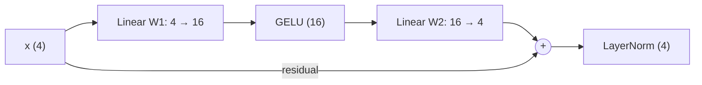

# Worked example: one token through one Transformer block

[back to the folder](README.md) · code: [`worked_example.py`](worked_example.py) reproduces every number on this page.

This page follows the word **"tree"** through a single, simplified Transformer block, with small numbers you can
check by hand. The attention weights and Value vectors are illustrative (chosen by hand); a real model computes them
from learned weights.

## 1. The sentence

"I am the tree I saw yesterday". Assume every word is one token, so there are seven tokens:

| Position | 1 | 2 | 3 | 4 | 5 | 6 | 7 |
| --- | --- | --- | --- | --- | --- | --- | --- |
| Token | I | am | the | tree | I | saw | yesterday |

Each token has a 4-dimensional representation, for example

$$x_{\text{tree}} = [2, 3, 4, 5].$$

Stack all seven as the rows of a $7 \times 4$ matrix $X$.

> These are the tokens' **current hidden representations**, not necessarily the original token embeddings. In deeper
> layers they have already been transformed by the blocks before.

## 2. Queries, Keys and Values

Every token gets its **own** Query, Key and Value vector, from three learned weight matrices shared by all tokens:

$$Q = XW_Q, \qquad K = XW_K, \qquad V = XW_V.$$

Here $W_Q$, $W_K$, $W_V$ are learned. For simplicity all three produce 4-dimensional vectors, so $Q$, $K$ and $V$ are
each $7 \times 4$.

## 3. How much does "tree" attend to each token?

Compare the Query of "tree" with all seven Keys (row-vector notation):

$$\text{scores} = \frac{q_{\text{tree}} K^\top}{\sqrt{d_k}} \qquad (1 \times 4)\cdot(4 \times 7) = 1 \times 7.$$

That gives seven numbers. Softmax turns them into weights that are non-negative and sum to 1. Suppose they are

$$a = \text{softmax}(\text{scores}) = [0.5,\ 0.2,\ 0.2,\ 0.1,\ 0,\ 0,\ 0].$$

| Token | I (1) | am | the | tree | I (5) | saw | yesterday |
| --- | --- | --- | --- | --- | --- | --- | --- |
| Weight from "tree" | 0.5 | 0.2 | 0.2 | 0.1 | 0 | 0 | 0 |

So "tree" pays the most attention to the first "I".

The zeros on positions 5 to 7 are exactly what a **causal mask** produces in a decoder (GPT-style) model: a token may
only look at itself and earlier positions. In an encoder (BERT-style) model, those weights would generally be
non-zero.

> **Common mistake:** the scores are $QK^\top$, not $QV$. Queries are matched against Keys; the Values come in only
> after the softmax. Dividing by $\sqrt{d_k}$ (here $\sqrt 4 = 2$) keeps the scores from growing with the dimension
> and saturating the softmax.

## 4. Weighted sum of the Values

Assume the Value vectors are:

| Token | I (1) | am | the | tree | I (5) | saw | yesterday |
| --- | --- | --- | --- | --- | --- | --- | --- |
| $v_j$ | [2, 3, 4, 5] | [1, 2, 1, 3] | [2, 1, 2, 1] | [3, 2, 1, 2] | [1, 1, 1, 1] | [2, 2, 2, 2] | [1, 2, 3, 4] |

Multiply **every** Value by its weight and **add all seven**:

$$\text{out}_{\text{tree}} = \sum_{j=1}^{7} a_j v_j$$

$$
\begin{aligned}
\text{out}_{\text{tree}} ={}& 0.5\,[2,3,4,5] + 0.2\,[1,2,1,3] + 0.2\,[2,1,2,1] + 0.1\,[3,2,1,2] + 0 + 0 + 0 \\
={}& [1, 1.5, 2, 2.5] + [0.2, 0.4, 0.2, 0.6] + [0.4, 0.2, 0.4, 0.2] + [0.3, 0.2, 0.1, 0.2] \\
={}& [1.9,\ 2.3,\ 2.7,\ 3.5].
\end{aligned}
$$

> **Common mistake:** multiplying only the largest weight by its Value ($0.5\,v_{\text{I}}$). The output is the whole
> weighted sum.

The result is still 4-dimensional: attention has mixed information from all seven tokens into a new representation
of "tree". In matrix form, for all tokens at once, $\text{Attention}(Q,K,V) = \text{softmax}(QK^\top/\sqrt{d_k})\,V$.

## 5. Residual connection and LayerNorm

Add the block's input back (the **residual connection**):

$$[1.9, 2.3, 2.7, 3.5] + [2, 3, 4, 5] = [3.9,\ 5.3,\ 6.7,\ 8.5].$$

**LayerNorm** then normalizes the features *within this one token's vector*:

1. Mean: $\mu = (3.9 + 5.3 + 6.7 + 8.5)/4 = 6.1$.
2. Variance: deviations are $[-2.2, -0.8, 0.6, 2.4]$, so
   $\sigma^2 = (4.84 + 0.64 + 0.36 + 5.76)/4 = 11.6/4 = 2.9$ and $\sigma \approx 1.703$.
3. Normalize: $\hat x_i = (x_i - \mu)/\sqrt{\sigma^2 + \epsilon}$. Ignoring the tiny stabilizer $\epsilon$,

   $$\hat x \approx [-1.292,\ -0.470,\ 0.352,\ 1.409].$$

4. Scale and shift with learned parameters: $y_i = \gamma_i \hat x_i + \beta_i$. With $\gamma = 1$ and $\beta = 0$ the
   vector is unchanged.

| Stage | Vector |
| --- | --- |
| residual sum | [3.9, 5.3, 6.7, 8.5] |
| mean, variance | 6.1, 2.9 |
| normalized | [−1.292, −0.470, 0.352, 1.409] |

LayerNorm treats each token **independently** across its feature dimensions. It never mixes the seven tokens
(BatchNorm, by contrast, normalizes each feature across the examples in a batch).

## 6. The MLP: 4 → 16 → 4

A useful picture: the first MLP layer asks **16 questions** of the same four features. Each of 16 neurons has its own
weights over all four inputs:

$$h_k = w_{k1}x_1 + w_{k2}x_2 + w_{k3}x_3 + w_{k4}x_4 + b_k, \qquad h = W_1 x + b_1,$$

with $W_1 \in \mathbb{R}^{16 \times 4}$ and $b_1, h \in \mathbb{R}^{16}$. A nonlinearity follows (GELU, or a gated
variant such as SwiGLU, depending on the architecture).

But the residual connection needs to add the MLP's output to its 4-dimensional input, and **a 16-vector cannot be added
to a 4-vector**. So the MLP has a second linear layer that projects back down (the *down-projection*):

$$\text{MLP}(x) = W_2\,\text{GELU}(W_1 x + b_1) + b_2, \qquad W_2 \in \mathbb{R}^{4 \times 16}.$$

Expanding gives room for richer nonlinear features; projecting back keeps every block's input and output the same
size so blocks can be stacked. In real LLMs the expansion is large, e.g. a 4,096-dimensional model with an MLP width
of about 11,000 (roughly 4× for GELU MLPs, about 2.7× for SwiGLU).

**The MLP processes each token independently, with the same weights.** It is applied row by row to the $7 \times 4$
matrix (equivalently, one $7 \times 4$ by $4 \times 16$ matrix product); it never sees the seven tokens as one long
vector. Attention is the **only** place where tokens exchange information; the MLP then transforms each token on its own.
`worked_example.py` checks this: running the MLP on each row separately gives the same result as on the whole matrix.

## 7. The whole journey

1. **Input**: the representation of "tree", [2, 3, 4, 5].
2. **Q, K, V**: learned projections of every token's representation.
3. **Scores**: the Query of "tree" against all seven Keys, divided by $\sqrt{d_k}$.
4. **Softmax**: seven attention weights (zero on future positions if causal).
5. **Weighted sum of Values**: one 4-dimensional attention output, [1.9, 2.3, 2.7, 3.5].
6. **Residual + LayerNorm**: [3.9, 5.3, 6.7, 8.5] → [−1.292, −0.470, 0.352, 1.409].
7. **MLP expansion**: 4 → 16, then GELU.
8. **MLP projection**: 16 → 4.
9. **Residual + LayerNorm**: the updated "tree", ready for the next block.

### Nuances the simplified picture leaves out

- **Pre-norm vs. post-norm.** This page uses the original *post-norm* order (add, then normalize). Most modern LLMs,
  and [`transformer.py`](transformer.py) in this folder, use *pre-norm*: $x + \text{Attn}(\text{LN}(x))$, then
  $x + \text{MLP}(\text{LN}(x))$. It trains more stably in deep stacks. The dimensions are the same either way.
- **Multiple heads and the output projection.** With $h$ heads, each head works in a smaller dimension
  $d_k = d/h$; the head outputs are concatenated and multiplied by a learned $W_O \in \mathbb{R}^{d \times d}$ before
  the residual addition. Even with one head, real models apply $W_O$; this page skips it.
- **Position information.** Attention by itself ignores order (the two "I"s would look identical), so position
  encodings (sinusoidal, learned, or RoPE) are added to or rotated into the representations.

## Check yourself

- Why must the scores be $q K^\top$ and not $q V^\top$? What role does each of Q, K, V play?
- If "tree" were at position 4 in an encoder (no mask), which weights could become non-zero?
- What are the shapes of $W_Q$, $W_1$ and $W_2$ for a model with $d = 4{,}096$ and an MLP width of 16,384?
- The two "I" tokens have the same embedding. What makes their representations differ after one block?
