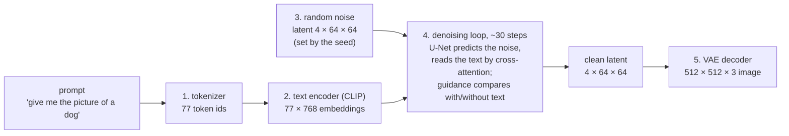
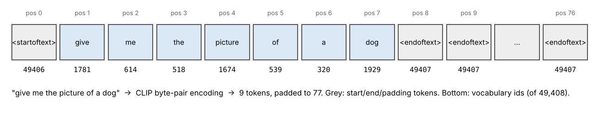
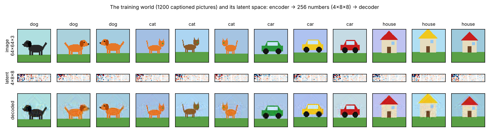
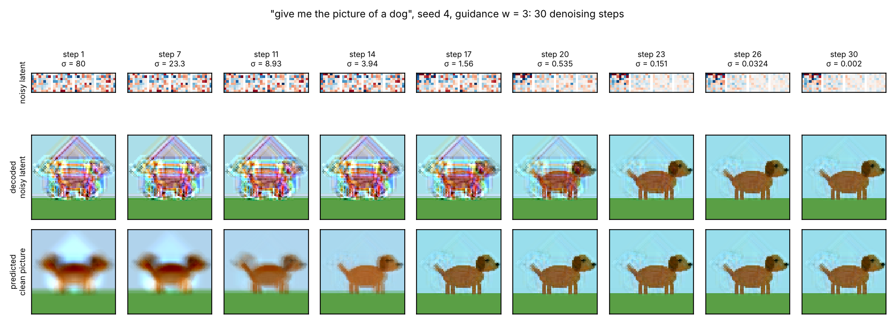
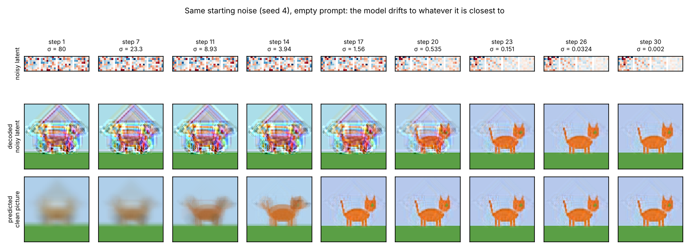
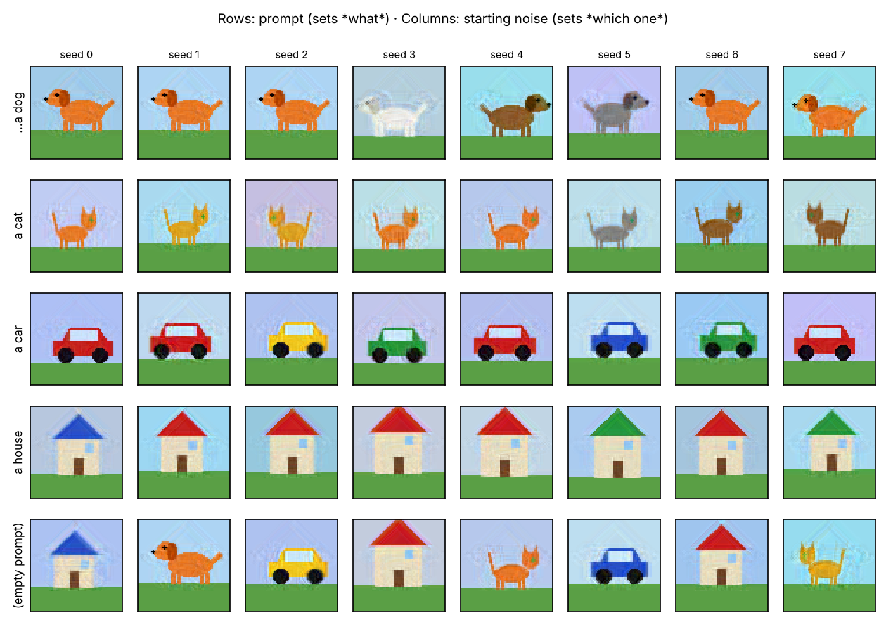

# From "give me the picture of a dog" to a picture, step by step

[back to the folder](README.md) · code: [`prompt_to_image.py`](prompt_to_image.py) (makes every figure below, about
10 s on a CPU)

This page follows one prompt through a latent text-to-image diffusion model like Stable Diffusion. For each stage it
gives what the real model does (numbers for Stable Diffusion 1.5) and a figure from a **miniature model that runs
here**. The miniature has the same stages: a tokenizer, a text condition, an autoencoder with a 4-channel latent, a
noise-to-image denoising loop with classifier-free guidance, and a decoder. It lives in a toy world of 1200 cartoon
pictures of dogs, cats, cars and houses.

> **What is real and what is toy.** The token ids are real (computed with Stable Diffusion's own CLIP tokenizer
> vocabulary). Every image in the figures is computed, not drawn by hand. The simplifications: the toy's "text
> encoder" only recognises the class word, its autoencoder is linear (PCA), and its denoiser is the *exact* optimal
> denoiser for the 1200 training pictures instead of a trained U-Net. Because of that last point, each toy sample
> ends on one of the training pictures. A trained network only approximates this denoiser, and that is why it can
> make new pictures (see "Knowledge gap" in the [folder README](README.md)).

## The pipeline at a glance

| Stage | Stable Diffusion 1.5 | The miniature in this folder |
| --- | --- | --- |
| 1. Tokenize | CLIP byte-pair encoding, vocabulary 49,408, padded to 77 tokens | the same tokenizer (real ids) |
| 2. Encode text | CLIP ViT-L/14 text Transformer, 12 layers → **77 × 768** | picks the class word ("dog") |
| 3. Start from noise | Gaussian latent **4 × 64 × 64** from the seed | Gaussian latent **4 × 8 × 8** from the seed |
| 4. Denoise | U-Net (≈ 860M parameters) with cross-attention to the text; 20–50 sampler steps; guidance scale ≈ 7.5 | exact denoiser for the training set; 30 Euler steps (EDM schedule); guidance 3 |
| 5. Decode | VAE decoder, 8× upsampling → **512 × 512 × 3** | PCA decoder → **64 × 64 × 3** |

## 1. Tokenize: text becomes integers

The prompt is lower-cased and split by CLIP's **byte-pair encoding** (the BPE of [17](../17-sequence-models-and-transformers/)):
common words are one token each, rare words split into pieces ("corgi" is one token; "skateboarding" too, but an
invented word would be several). The sequence gets a start token (49406) and an end token (49407), and it is padded
to exactly 77 positions. Anything beyond 77 tokens is cut off.

Notice that "give me the" is just three more tokens. The model has no notion of a request: it was trained on
(image, caption) pairs, so it treats the prompt as a **caption** of the picture it should produce. "a photo of a dog"
works at least as well.

## 2. Encode the text: integers become vectors that know their context

Each id is looked up in an embedding table (768 numbers per token), a position embedding is added, and the 77 vectors
go through CLIP's 12-layer Transformer text encoder. The result is a **77 × 768 matrix**, one context-aware vector per
token. The vector at "dog" now also carries "picture of a". This encoder was trained by CLIP to put an image and its
caption close together ([19](../19-representation-learning-and-llms/)), so its vectors describe *visual* content. In
Stable Diffusion it stays frozen.

The empty prompt `""` is encoded too. Classifier-free guidance (stage 4) needs a "no text" version of every
prediction.

In the miniature, this stage is the function `text_condition`, which returns the class word it finds ("dog").

## 3. Start from random noise in a latent space

Diffusion runs in the latent space of an autoencoder rather than on pixels, because that is 48× cheaper
(4 × 64 × 64 = 16,384 numbers instead of 512 × 512 × 3 = 786,432). The autoencoder is trained once, separately, to
compress and reconstruct images.

The toy autoencoder squeezes each 64 × 64 × 3 picture into 4 × 8 × 8 = 256 numbers, which keep 96% of the pixel
variance (bottom row: what comes back out).

Generation starts with a latent of pure Gaussian noise, drawn from a random-number generator. **The seed fixes that
noise.** Same seed, same prompt and same settings give the same picture.

## 4. The denoising loop: noise becomes a dog

At each of about 30 steps the model looks at the current noisy latent and the noise level and predicts the clean
latent (equivalently, the noise to remove). The sampler then takes a step toward that prediction, lowering the noise
level. In Stable Diffusion each step is:

1. **Two U-Net passes**, one with the prompt's 77 × 768 embeddings and one with the empty prompt's.
2. Inside the U-Net, **cross-attention** layers at several resolutions let every spatial position read the text:
   queries come from the image features, keys and values from the 77 text vectors. Positions where the dog is forming
   attend strongly to the "dog" token (Hertz et al. 2022 visualise these maps).
3. **Classifier-free guidance** combines the two predictions:
   `prediction = unconditional + w · (conditional − unconditional)`, with `w ≈ 7.5`. The difference between them is
   "what the text adds", and guidance exaggerates it so the picture follows the prompt more closely.
4. The **sampler** (DDIM, Euler, DPM-Solver, …) moves the latent to the next, lower noise level.

Here is the miniature doing exactly this for our prompt, seed 4:

- **Top row:** the latent itself (4 channels of 8 × 8), as noise drains out of it.
- **Middle row:** what the decoder would show if you stopped there (the noisy latent, decoded).
- **Bottom row:** the model's current guess of the final picture.

At step 1 the guess is the **average of all dogs**: a blurry brown dog shape on grass. The prompt has already set the
*kind* of picture, but nothing specific. Over the next 10 to 15 steps (σ from about 9 to 1.5) the guess commits to one
particular dog: its colour, the direction it faces, its position. The last steps only sharpen details. Content first,
details last is how real models behave too. It is why the first few steps matter most and why fast samplers spend
their steps where the noise is low.

### The same noise without the prompt

Same seed, so the same starting noise, but with an empty prompt. Now the first guess is the average of *everything*
(dog, cat, car and house blended), and the trajectory settles on a cat. The noise alone doesn't contain a dog. The
prompt is what steers each step toward dogs.

## 5. Decode: latent becomes pixels

When the noise level reaches 0, the latent goes once through the VAE decoder, which turns 4 × 64 × 64 into a
512 × 512 × 3 image (here, 4 × 8 × 8 into 64 × 64 × 3). This is the only time the decoder runs. Real UIs show
"previews" during sampling by decoding the predicted clean latent, like the bottom row above.

## Which dog do you get? Prompt vs. seed

- **The prompt sets *what*.** With "…a dog", all 40 seeds tried end on a dog. With an empty prompt the 40 seeds end on
  cars (14), houses (12), cats (10) and dogs (4).
- **The seed sets *which one*:** colour, pose, background. To get a different dog, change the seed. To keep one you
  like while editing the prompt slightly, keep the seed.
- Several seeds land on the same orange dog. That is the exact denoiser's memorization of its 300 training dogs. A
  trained network gives every seed its own new dog.

To get closer to a *particular* dog you already have, use image-to-image (start from that image with noise added
part-way, as in §9 of the [digits notebook](diffusion_digits.ipynb)). To steer the content more precisely, use more
specific prompts, negative prompts (which replace the empty prompt in guidance), or extra conditions such as
ControlNet.

## Reading

Rombach et al. 2022, "High-resolution image synthesis with latent diffusion models" (Stable Diffusion); Radford et
al. 2021 (CLIP); Ho & Salimans 2022 (classifier-free guidance); Hertz et al. 2022, "Prompt-to-prompt image editing
with cross-attention control"; Zhang, Rao & Agrawala 2023 (ControlNet); Jay Alammar, "The illustrated Stable Diffusion".
