# Machine learning: a knowledge graph of CPSC 340 + CPSC 440

Notes and code for two UBC courses, built from their lecture slides:

- **CPSC 340, Machine Learning and Data Mining** (Fall 2025, Bajpai & Lécuyer), slides `L1`–`L36`.
- **CPSC 440/550, Advanced Machine Learning** (Sutherland), slides `0`–`24`.

Every model in the slides lives in exactly one topic folder. Each folder's README has the lectures it comes from, an
explanation of every model (what it learns, how it is trained, the key equations), the code written for it with
results, a **knowledge gap** section, and how the topic connects to the others.

**Knowledge gap** means three things in every folder: *what the slides leave out* (derivations, theory, and the
practical details that the lectures skip or push to bonus slides), *prerequisites to shore up* before the topic makes
sense, and *open questions* with concrete readings for going further.

## The graph

Click a node to open its folder. Edges are the conceptual links between topics, labelled with the idea that carries
over.

```mermaid
flowchart LR
    subgraph S["Supervised learning (CPSC 340 Parts 1, 3)"]
        F["00 Learning fundamentals<br/>train/val/test · CV"]
        EV["20 Evaluation<br/>leakage · skew · A/B tests"]
        T["01 Trees and ensembles<br/>trees · random forests · boosting"]
        NB["02 Naive Bayes and kNN"]
        LR["04 Linear regression<br/>least squares · GD · robust · RBF"]
        RG["05 Feature selection and<br/>regularization · L2 · L1"]
        LC["06 Linear classifiers and kernels<br/>logistic · SVM · softmax · SGD"]
    end
    subgraph U["Unsupervised learning (CPSC 340 Parts 2, 4)"]
        CL["03 Clustering and outliers<br/>k-means · DBSCAN · hierarchical"]
        LF["09 Latent-factor models<br/>PCA · recommenders · MDS"]
    end
    subgraph P["Probabilistic modelling (CPSC 440)"]
        DE["07 Density estimation<br/>MLE · MAP · exponential families"]
        GA["08 Gaussians and Bayesian learning<br/>GDA · Bayesian linear regression · empirical Bayes"]
        MX["10 Mixtures and EM<br/>GMM · EM · KDE"]
        MC["11 Monte Carlo and MCMC<br/>IS · Laplace · Metropolis · Gibbs"]
        VI["12 Variational inference and VAEs"]
        MK["13 Markov chains and HMMs<br/>Viterbi · forward-backward"]
        GM["14 Graphical models<br/>DAGs · UGMs · CRFs"]
    end
    subgraph D["Deep learning (CPSC 340 Part 5, CPSC 440)"]
        NN["15 Neural networks<br/>backprop · deep nets"]
        CN["16 CNNs<br/>convolution · transposed conv"]
        SQ["17 Sequence models<br/>RNN · LSTM · Transformer"]
        DF["18 Diffusion and image generation"]
        RP["19 Representation learning and LLMs<br/>contrastive · RLHF · fairness"]
    end

    F -- "held-out error for every model" --> T
    F -- "how the protocol breaks in practice" --> EV
    MC -- "IPS = importance sampling" --> EV
    T -- "same three first classifiers" --> NB
    LR -- "a penalty on w" --> RG
    RG -- "same penalties, classification losses" --> LC
    T -- "gradient boosting = GD with trees" --> LR
    NB -- "generative vs. discriminative" --> LC
    NB -- "Laplace smoothing = Beta prior" --> DE
    CL -- "k-means = hard EM" --> MX
    CL -- "k-means = one-hot factorization" --> LF
    DE -- "continuous, conjugate" --> GA
    RG -- "L2 = Gaussian prior; BIC ≈ marginal likelihood" --> GA
    GA -- "GDA with hidden labels" --> MX
    LC -- "Bayesian logistic regression" --> MC
    MX -- "ELBO" --> VI
    MC -- "optimize instead of sample" --> VI
    LF -- "PCA = linear autoencoder" --> VI
    DE -- "chain of categoricals" --> MK
    MX -- "Baum-Welch = EM" --> MK
    MK -- "chains are the simplest graphs" --> GM
    MK -- "MCMC needs a stationary distribution" --> MC
    GA -- "zeros of the precision matrix" --> GM
    LC -- "learn the features" --> NN
    NN -- "shared local weights" --> CN
    NN -- "unroll over time" --> SQ
    MK -- "RNN = deterministic-state HMM" --> SQ
    CN -- "transposed conv decoders" --> VI
    VI -- "hierarchical VAE, fixed encoder" --> DF
    CN -- "U-net denoiser" --> DF
    SQ -- "pre-train, fine-tune, RLHF" --> RP
    LF -- "word2vec embeddings" --> SQ
    RP -- "CLIP conditioning" --> DF

    click F "00-learning-fundamentals/" "Learning fundamentals"
    click T "01-decision-trees-and-ensembles/" "Decision trees and ensembles"
    click NB "02-naive-bayes-and-knn/" "Naive Bayes and kNN"
    click CL "03-clustering-and-outliers/" "Clustering and outliers"
    click LR "04-linear-regression/" "Linear regression"
    click RG "05-feature-selection-and-regularization/" "Feature selection and regularization"
    click LC "06-linear-classifiers-and-kernels/" "Linear classifiers and kernels"
    click DE "07-density-estimation-mle-map/" "Density estimation"
    click GA "08-gaussians-and-bayesian-learning/" "Gaussians and Bayesian learning"
    click LF "09-latent-factor-models/" "Latent-factor models"
    click MX "10-mixture-models-and-em/" "Mixtures and EM"
    click MC "11-monte-carlo-and-mcmc/" "Monte Carlo and MCMC"
    click VI "12-variational-inference-and-vaes/" "Variational inference and VAEs"
    click MK "13-markov-chains-and-hmms/" "Markov chains and HMMs"
    click GM "14-graphical-models/" "Graphical models"
    click NN "15-neural-networks/" "Neural networks"
    click CN "16-convolutional-networks/" "CNNs"
    click SQ "17-sequence-models-and-transformers/" "Sequence models"
    click DF "18-diffusion-and-image-generation/" "Diffusion"
    click RP "19-representation-learning-and-llms/" "Representation learning and LLMs"
    click EV "20-evaluation/" "Evaluation"
```



If the nodes are not clickable in your viewer (GitHub sometimes disables Mermaid links), use the table below.

## Topics, lectures and code

| Topic folder | Lectures (slide files) | Models explained | Code in this repo |
| --- | --- | --- | --- |
| [00 Learning fundamentals](00-learning-fundamentals/) | 340: L1, L2, L4, L5 | train/validation/test, fundamental trade-off, optimization bias, cross-validation, no free lunch | [`cross_validation.py`](00-learning-fundamentals/cross_validation.py) |
| [01 Decision trees and ensembles](01-decision-trees-and-ensembles/) | 340: L3, L7, L8, L23 | decision stumps and trees, random forests, AdaBoost, gradient boosting / XGBoost | [`decision_tree.py`](01-decision-trees-and-ensembles/decision_tree.py), [`random_forest.py`](01-decision-trees-and-ensembles/random_forest.py), [`boosting.py`](01-decision-trees-and-ensembles/boosting.py) |
| [02 Naive Bayes and kNN](02-naive-bayes-and-knn/) | 340: L5, L6, L7 · 440: 3 | naive Bayes, Laplace smoothing, decision theory, kNN, curse of dimensionality | [`naive_bayes.py`](02-naive-bayes-and-knn/naive_bayes.py), [`knn.py`](02-naive-bayes-and-knn/knn.py) |
| [03 Clustering and outliers](03-clustering-and-outliers/) | 340: L8, L9, L10 | k-means, k-means++, DBSCAN, agglomerative clustering, z-score, kNN and local outlier scores | [`clustering.py`](03-clustering-and-outliers/clustering.py), [`outliers.py`](03-clustering-and-outliers/outliers.py) |
| [04 Linear regression](04-linear-regression/) | 340: L11, L12, L13, L14, L17 | least squares, change of basis, gradient descent, convexity, L1 / Huber robust regression, RBFs | [`linear_regression.py`](04-linear-regression/linear_regression.py) |
| [05 Feature selection and regularization](05-feature-selection-and-regularization/) | 340: L14–L18 | forward selection, AIC / BIC, ridge, lasso, standardization | [`regularization.py`](05-feature-selection-and-regularization/regularization.py) |
| [06 Linear classifiers and kernels](06-linear-classifiers-and-kernels/) | 340: L18–L22 · 440: 4, 5 | perceptron, SVM, logistic and softmax regression, feature engineering, kernel trick, SGD | [`linear_classifiers.py`](06-linear-classifiers-and-kernels/linear_classifiers.py), [`kernels.py`](06-linear-classifiers-and-kernels/kernels.py) |
| [07 Density estimation, MLE and MAP](07-density-estimation-mle-map/) | 440: 1, 2, 3, 4, 10 · 340: L24 | Bernoulli / Beta, categorical / Dirichlet, product of Bernoullis, conjugacy, exponential families, GLMs | [`density_estimation.py`](07-density-estimation-mle-map/density_estimation.py), [`exponential_family.py`](07-density-estimation-mle-map/exponential_family.py) |
| [08 Gaussians and Bayesian learning](08-gaussians-and-bayesian-learning/) | 440: 6, 7, 8, 9 | multivariate Gaussians, QDA / LDA, Bayesian linear regression, posterior predictive, empirical Bayes | [`gaussians.py`](08-gaussians-and-bayesian-learning/gaussians.py), [`bayesian_linear_regression.py`](08-gaussians-and-bayesian-learning/bayesian_linear_regression.py) |
| [09 Latent-factor models](09-latent-factor-models/) | 340: L25–L28 | PCA, robust PCA, NMF, matrix factorization recommenders, MDS, t-SNE, word2vec | [`latent_factors.py`](09-latent-factor-models/latent_factors.py) |
| [10 Mixtures and EM](10-mixture-models-and-em/) | 440: 11 | Gaussian and Bernoulli mixtures, EM, the ELBO, KDE, mean-shift | [`mixtures.py`](10-mixture-models-and-em/mixtures.py) |
| [11 Monte Carlo and MCMC](11-monte-carlo-and-mcmc/) | 440: 12, 18 | Monte Carlo, rejection and importance sampling, Laplace approximation, Metropolis–Hastings, Gibbs | [`monte_carlo.py`](11-monte-carlo-and-mcmc/monte_carlo.py), [`mcmc.py`](11-monte-carlo-and-mcmc/mcmc.py) |
| [12 Variational inference and VAEs](12-variational-inference-and-vaes/) | 440: 13, 14 · 340: L34 | reverse-KL VI, reparameterization, mean field, autoencoders, VAEs, conditional VAEs, β-VAE, posterior collapse | [`variational_inference.py`](12-variational-inference-and-vaes/variational_inference.py), [`vae.py`](12-variational-inference-and-vaes/vae.py) |
| [13 Markov chains and HMMs](13-markov-chains-and-hmms/) | 440: 16, 17, 20 | Markov chains, stationary distributions, PageRank, Viterbi, forward–backward, HMMs, Baum–Welch | [`markov_chain.py`](13-markov-chains-and-hmms/markov_chain.py), [`hmm.py`](13-markov-chains-and-hmms/hmm.py) |
| [14 Graphical models](14-graphical-models/) | 440: 19, 20 | DAGs, d-separation, UGMs, Ising models, pseudo-likelihood, graphical lasso, CRFs, LDA, RBMs | [`dag.py`](14-graphical-models/dag.py), [`ugm.py`](14-graphical-models/ugm.py) |
| [15 Neural networks](15-neural-networks/) | 340: L29, L30, L31 · 440: 4, 5 | MLPs, backpropagation, vanishing gradients, ReLU, skip connections, training tricks | [`mlp.py`](15-neural-networks/mlp.py) |
| [16 CNNs](16-convolutional-networks/) | 340: L32, L33 · 440: 5, 14 | convolution, filters, im2col, CNNs, pooling, transposed convolution, fully-convolutional nets | [`convolution.py`](16-convolutional-networks/convolution.py), [`cnn.py`](16-convolutional-networks/cnn.py) |
| [17 Sequence models and Transformers](17-sequence-models-and-transformers/) | 440: 21, 22 · 340: L35 | RNNs, LSTMs, seq2seq, BPE, beam search, attention, Transformers, BERT / GPT | [`rnn.py`](17-sequence-models-and-transformers/rnn.py), [`transformer.py`](17-sequence-models-and-transformers/transformer.py), [`tokens_and_decoding.py`](17-sequence-models-and-transformers/tokens_and_decoding.py), [worked example](17-sequence-models-and-transformers/worked-example.md) |
| [18 Diffusion and image generation](18-diffusion-and-image-generation/) | 440: 15 · 340: L36 | diffusion as a hierarchical VAE, DDPM, EDM (preconditioning, Heun sampler), classifier(-free) guidance, latent diffusion, evaluating generative models | [`diffusion.py`](18-diffusion-and-image-generation/diffusion.py), [`edm.py`](18-diffusion-and-image-generation/edm.py) |
| [19 Representation learning and LLMs](19-representation-learning-and-llms/) | 440: 23, 24 · 340: L35, L36 | pretext tasks, contrastive learning, CLIP, SFT, RLHF, failures, fairness | [`contrastive.py`](19-representation-learning-and-llms/contrastive.py) |
| [20 Evaluation](20-evaluation/) | beyond the slides; builds on 340: L4, L5 · 440: 15, 23, 24 | offline metrics and splits, data leakage, training-serving skew, A/B tests, peeking, interleaving, off-policy evaluation | [`leakage.py`](20-evaluation/leakage.py), [`skew.py`](20-evaluation/skew.py), [`online.py`](20-evaluation/online.py) |

`log-rank-test.pdf` in the same slide folder is a Stat 536 handout on the Mantel–Haenszel / log-rank test, not part
of either course, so it has no folder here.

## The thread through both courses: what is being learned?

A useful way to read the graph is to ask, for each folder, *what object the data are used to fit*:

- **A rule or a lookup** (01, 02): an if-then program, a table of counts, or the training set itself (kNN).
- **A weight vector for a fixed basis** (04, 05, 06): `ŷ = wᵀφ(x)`, with the choice of loss, penalty and basis (or
  kernel) doing all the modelling work.
- **A density over the data** (07, 08, 10, 13, 14): `p(x)` or `p(x, y)`, from a single Bernoulli up to graphical models
  with thousands of variables, so you can sample, fill in missing values, and reason about independence.
- **A posterior over parameters** (08, 11, 12): not one `w` but a distribution over `w`, computed exactly when the
  prior is conjugate and approximated by sampling (11) or optimization (12) when it is not.
- **A low-dimensional code** (09, 12, 19): `x ≈ decoder(z)`, from PCA's linear `ZW` to VAEs and contrastive encoders,
  where the code is the thing you keep.
- **The features themselves** (15, 16, 17): deep networks learn `φ` instead of hand-designing it, with architecture
  (convolution, recurrence, attention) as the inductive bias.
- **A sampler** (18): the diffusion denoiser is useful only through the process that turns noise into data.

## Knowledge gaps across both courses

Each folder lists its own gaps. Four themes recur often enough to plan study around:

1. **Theory of generalization.** Both courses state the fundamental trade-off and show double descent, but never derive
   a generalization bound or explain why over-parameterized networks generalize. Start with Shalev-Shwartz &
   Ben-David, *Understanding Machine Learning*, then the implicit-regularization literature.
2. **Optimization beyond gradient descent.** Convergence rates, conditioning, Newton and quasi-Newton methods,
   proximal methods, adaptive optimizers (Adam, which every deep-learning file here uses) and learning-rate schedules
   are used but not taught. Bottou, Curtis & Nocedal 2018 covers most of it.
3. **Inference algorithms in their modern form.** HMC/NUTS, normalizing flows, loopy belief propagation, fast diffusion
   samplers and flow matching all appear as names in bonus slides. These are what current probabilistic software and
   generative models actually run.
4. **Causality, evaluation and deployment.** Correlation vs. causation is a recurring warning (L16, lecture 19), and
   lecture 24 shows the failures, but structural causal models, distribution-shift methods, calibration, and rigorous
   evaluation (contamination, statistical testing of model comparisons) are left for later courses.

## Run the code

```bash
python -m venv .venv && source .venv/bin/activate
pip install -r requirements.txt
python 01-decision-trees-and-ensembles/random_forest.py      # any file runs on its own and prints its results
python -m pytest -q                                          # 33 checks against closed forms, brute force and scikit-learn
```

Most scripts finish in seconds on a laptop CPU; `rnn.py`, `transformer.py` and `contrastive.py` take 1–2 minutes. Results quoted in the topic
READMEs come from these scripts with their fixed random seeds.

## Layout

```
.
├── 00-learning-fundamentals/            each folder: README.md + one or more runnable .py files
├── 01-decision-trees-and-ensembles/
├── 02-naive-bayes-and-knn/
├── 03-clustering-and-outliers/
├── 04-linear-regression/
├── 05-feature-selection-and-regularization/
├── 06-linear-classifiers-and-kernels/
├── 07-density-estimation-mle-map/
├── 08-gaussians-and-bayesian-learning/
├── 09-latent-factor-models/
├── 10-mixture-models-and-em/
├── 11-monte-carlo-and-mcmc/
├── 12-variational-inference-and-vaes/
├── 13-markov-chains-and-hmms/
├── 14-graphical-models/
├── 15-neural-networks/
├── 16-convolutional-networks/
├── 17-sequence-models-and-transformers/
├── 18-diffusion-and-image-generation/
├── 19-representation-learning-and-llms/
├── 20-evaluation/                       leakage, training-serving skew, online evaluation (beyond the slides)
├── tests/test_models.py                 correctness checks for every implementation
└── requirements.txt
```

## Conventions

- **From scratch.** Classical models are pure NumPy (SciPy only for `logsumexp`, `expit` and a matrix square root).
  Models that need gradients through deep networks (VI, VAE, CNN, RNN, Transformer, diffusion, contrastive learning)
  use JAX for autodiff with no neural-network framework; parameters are plain pytrees and Optax provides Adam.
  scikit-learn is used only to load datasets and as a reference in the tests.
- **Small, real data.** Most demos use scikit-learn's bundled 8×8 digits (1797 images, no download), binarized where
  the model needs binary pixels, so results across folders are comparable: the digits log-likelihood ladder runs from
  −25.1 nats (product of Bernoullis, 07) to −19.4 (mixture of Bernoullis, 10) to −16.8 (VAE, 12).
- **One file per idea**, each with a docstring that states the model and its equations, and a `demo()` that prints
  the numbers quoted in the README.
